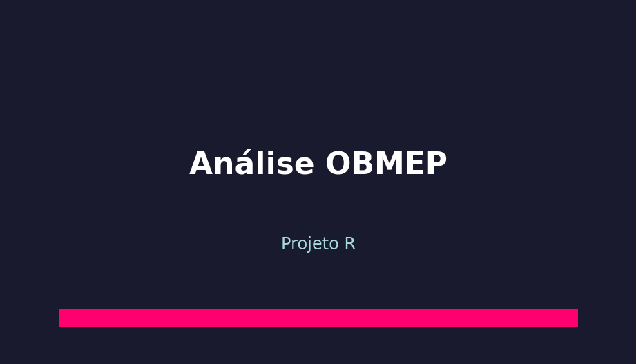

**Data de criação do código:** 1 de outubro de 2023

# Análise OBMEP



Análises sobre dados e questões da Olimpíada Brasileira de Matemática.

## Como executar

Arquivo(s) principal(is): `Analise Obmep/Analise.Rmd`.

```r
# Abra o projeto no RStudio ou, para Shiny:
# setwd(".../Analise Obmep")
# source("main.R")  # quando aplicável
```

## Stack

R, R Markdown

## Estrutura

- Código e notebooks na raiz ou subpastas do diretório do projeto.
- Imagem de capa: `docs/preview.png` (gerada ou copiada de saídas do próprio trabalho).
- Credenciais/dados privados: pasta `secrets/` (ver `SECRETS.md` na raiz do workspace, se existir).

## Dados

Shapefiles da malha municipal e arquivos compactados grandes ficam fora do Git. A malha oficial está em [IBGE — Malhas territoriais](https://www.ibge.gov.br/geociencias/organizacao-do-territorio/malhas-territoriais).

## Licença

Uso acadêmico/pessoal. Ajuste a licença antes de publicar no GitHub.

